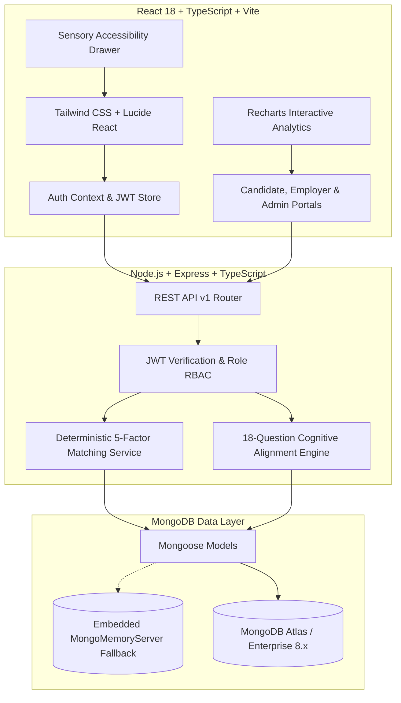

# Neurodivergent Career Exchange (NDCE)

[](https://www.typescriptlang.org/)
[](https://reactjs.org/)
[](https://vitejs.dev/)
[](https://nodejs.org/)
[](https://tailwindcss.com/)
[](https://mongoosejs.com/)
[](https://www.w3.org/WAI/standards-guidelines/wcag/)

> **A Strengths-First, Sensory-Accessible Employment Platform connecting Autistic, ADHD, and Neurodivergent Professionals with Inclusive Employers.**

---

## 🌟 Executive Summary & Mission

Traditional hiring processes rely on unstructured interviews, ambiguous social cues, high-stimulus assessment centers, and rigid workplace expectations. These systemic barriers lead to an estimated **30–40% chronic underemployment rate among neurodivergent adults**, despite exceptional cognitive capabilities in technical precision, pattern recognition, systematic verification, and deep problem-solving.

**Neurodivergent Career Exchange (NDCE)** bridges this gap by shifting the paradigm from *deficit-based medical disclosure* to *strengths-first cognitive alignment*. 

### Core Ethical Pillars
1. **Zero Mandatory Medical Disclosure**: Candidates are never asked or required to disclose clinical diagnoses. Privacy is fully preserved.
2. **Strengths-First Alignment**: Matching is calculated across 12 cognitive strengths and 6 specialized career disciplines.
3. **Transparent & Explainable Matching**: No black-box AI scores. Every percentage match provides an itemized breakdown across 5 factors.
4. **Predictable Interview Framework**: Ambush interviews and surprise questions are replaced with advance agendas, interviewer bios, and confirmed accommodations.
5. **Living "How I Work Best" Canvas**: A structured communication profile setting clear expectations between candidate and hiring manager.
6. **Sensory-Friendly Design System**: Persistent WCAG 2.1 AAA Accessibility Drawer featuring reduced motion, high-contrast borders, font scaling, and density toggles.

---

## 🏗 System Architecture



---

## 🚀 Key Feature Highlights

### 1. Candidate Experience
- **Interactive Career Fit Assessment**: 18 carefully constructed work-style and cognitive preference questions across 6 tracks (Software Testing / QA, Cybersecurity, Data Analysis / Audit, Software Engineering, UI/UX, Documentation).
- **Transparent Results Hub**: Interactive comparison bars showing alignment across all 6 tracks with clear, non-diagnostic rationales.
- **Explainable Job Matching**: Every job listing features a dynamic match percentage and a modal explaining the breakdown across:
  - Skills Overlap (30%)
  - Work Environment Fit (25%)
  - Cognitive Strengths Alignment (20%)
  - Experience Level Match (15%)
  - Guaranteed Accommodations Fit (10%)
- **Living "How I Work Best" Canvas**: Custom workspace canvas defining optimal communication style, meeting cadence, focus blocks, and requested accommodations.
- **Dual-View ATS Application Tracker**: Kanban board and list view allowing candidates to track application stages (`Applied` ➔ `Screening` ➔ `Interviewing` ➔ `Offer Extended`).
- **Predictable Interview Hub**: Structured interview cards detailing the meeting agenda, confirmed accommodations, interviewer bios, and prep questions in advance.

### 2. Employer & Recruiter Experience
- **Inclusive Job Posting Creator**: Define role essentials, salary transparency, target cognitive traits, and guaranteed inclusive workplace accommodations.
- **Candidate Discovery**: Search candidate profiles by cognitive strengths, communication preferences, and work modes while respecting privacy controls.
- **Pipeline Stage Mover**: Review applicants with match percentages, add private recruiter notes, and transition applicants through ATS stages.
- **Predictable Interview Scheduler**: Create interview invites with mandatory agendas, interviewer bios, and preparation questions.

### 3. Administrative Operations
- **Executive KPI Dashboard**: Macro view of total candidates, partner companies, active postings, and placement rates.
- **Platform Analytics (Recharts)**: Interactive charts analyzing job distribution across cognitive disciplines and pipeline conversion rates.
- **Job Moderation**: Audit job postings for neuro-inclusive standards with one-click publish, unpublish, and archive controls.
- **Application Oversight**: Real-time audit trail of all candidate submissions across the platform.
- **Knowledge Base CMS**: Author and manage sensory work guides, interview playbooks, and accommodation toolkits.
- **System Health Monitor**: Live telemetry for database engines, JWT encryption, and matching service latency.

---

## 🛠 Tech Stack

| Domain | Technologies |
| :--- | :--- |
| **Frontend** | React 18, TypeScript, Vite, Tailwind CSS, Lucide React, Recharts, React Router v6 |
| **Backend** | Node.js (v20+ / v24), Express, TypeScript, Mongoose ODM, JWT, bcrypt |
| **Database** | MongoDB with automatic fallback to high-performance embedded `mongodb-memory-server` |
| **Accessibility** | WCAG 2.1 AA/AAA Sensory Compliance, Persistent Accessibility Drawer |
| **Architecture** | Clean Layered MVC, Explainable Deterministic Matching Algorithm |

---

## 🔑 Demo Accounts (Pre-Seeded)

The database automatically seeds with realistic enterprise demo data on initial startup:

| Role | Email Address | Password | Profile Highlights |
| :--- | :--- | :--- | :--- |
| **Candidate** | `candidate@demo.com` | `Demo@2026!` | Jordan Taylor (QA Automation Engineer, 96% QA / Data fit) |
| **Employer** | `employer@demo.com` | `Demo@2026!` | NeuroTech Labs (Verified Inclusive Employer, 4 active jobs) |
| **Admin** | `admin@demo.com` | `Demo@2026!` | System SuperAdmin (Full moderation & analytics oversight) |

> 💡 **Quick Login:** The Login screen features 1-click **Demo Login** buttons for instant role switching during presentations and portfolio reviews.

---

## 💻 Quick Start & Local Setup

### 1. Prerequisites
- [Node.js](https://nodejs.org/) v20.x or higher
- npm v10.x or higher

### 2. Installation
Clone the repository and install all dependencies:
```bash
git clone https://github.com/your-username/neurodivergent-career-exchange.git
cd neurodivergent-career-exchange

# Install backend and frontend dependencies
npm run install:all
```

### 3. Running the Development Servers
Open two terminal windows (or run in background):

**Terminal 1 — Backend:**
```bash
npm run dev:backend
```
*The backend connects to `MONGODB_URI` if provided in `backend/.env`, or automatically launches an embedded in-memory MongoDB instance with pre-seeded demo data on `http://localhost:5001`.*

**Terminal 2 — Frontend:**
```bash
npm run dev:frontend
```
*The Vite dev server starts on `http://localhost:5173` with automatic API proxying to `http://localhost:5001`.*

### 4. Production Build
```bash
# Build both frontend and backend
npm run build:backend
npm run build:frontend
```

---

## 📡 REST API Reference Summary

### Authentication (`/api/v1/auth`)
- `POST /register`: Register candidate or employer account.
- `POST /login`: Authenticate and issue JWT.
- `GET /me`: Fetch authenticated session user and profile.
- `POST /logout`: Invalidate session.

### Candidates (`/api/v1/candidates`)
- `GET /profile`: Get candidate profile & "How I Work Best" canvas.
- `PUT /profile`: Update profile, strengths, and accommodations.
- `GET /search`: Search candidate directory (Employer only).
- `GET /:id`: View candidate profile details.

### Assessments (`/api/v1/assessments`)
- `GET /questions`: Retrieve 18 assessment questions across 6 disciplines.
- `POST /submit`: Score candidate responses and record alignment.
- `GET /my-results`: Fetch candidate's cognitive match percentages.

### Jobs (`/api/v1/jobs`)
- `GET /`: Search and filter jobs with personalized candidate matching.
- `GET /:id`: Fetch single job details and accommodation commitments.
- `POST /`: Create new job posting (Employer only).
- `PUT /:id`: Update existing job posting (Employer only).
- `PATCH /:id/status`: Toggle job publish status (`PUBLISHED`, `CLOSED`, `DRAFT`).
- `DELETE /:id`: Remove job posting.
- `POST /:id/save`: Toggle saved job bookmark.
- `GET /candidate/saved`: Retrieve bookmarked jobs.

### Applications & ATS (`/api/v1/applications`)
- `POST /`: Submit job application with requested accommodations.
- `GET /my-applications`: Get candidate's applications with pipeline stages.
- `GET /job-applications`: Review applicants for employer's postings.
- `PATCH /:id/status`: Update applicant stage (`APPLIED`, `SCREENING`, `INTERVIEWING`, `OFFER`, `REJECTED`).
- `POST /:id/notes`: Add private recruiter notes.
- `POST /:id/withdraw`: Candidate withdraws application.

### Interviews (`/api/v1/interviews`)
- `POST /`: Schedule structured interview with agenda & prep questions.
- `GET /my-interviews`: Fetch scheduled interviews.
- `PATCH /:id/status`: Update interview status.

### Admin Operations (`/api/v1/admin`)
- `GET /stats`: Retrieve macro platform statistics and category distributions.
- `GET /users`: List and search all platform users.
- `PATCH /users/:id/status`: Toggle user active/suspended state.
- `GET /jobs`: Retrieve and moderate platform job postings.
- `PATCH /jobs/:id/status`: Moderate job visibility.
- `DELETE /jobs/:id`: Remove job posting.
- `GET /applications`: System-wide audit log of all candidate submissions.

---

## 🎨 Sensory-Friendly & Ethical Design Principles

- **WCAG 2.1 AAA Contrast:** All text meets high-contrast readability ratios.
- **Predictable Interactions:** Forms provide real-time validation, clear feedback, and no abrupt auto-advances.
- **Reduced Motion:** Configurable reduced motion turns off high-velocity transforms and jarring transitions.
- **Calm Color Palette:** Calming slate, teal, and indigo tones reduce visual fatigue and overstimulation.
- **Persistent Accessibility Drawer:** Accessible from any page via the top navigation bar or quick settings.

---

## 📄 License
MIT License. Created for inclusive hiring advancement and portfolio demonstration.
